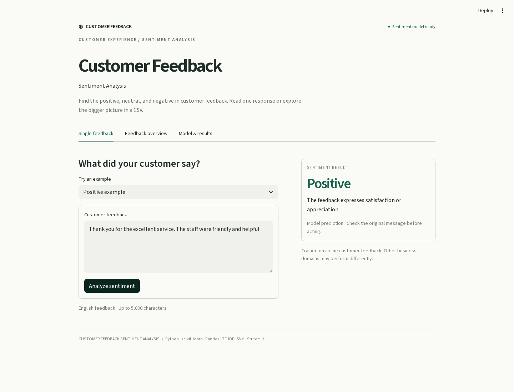
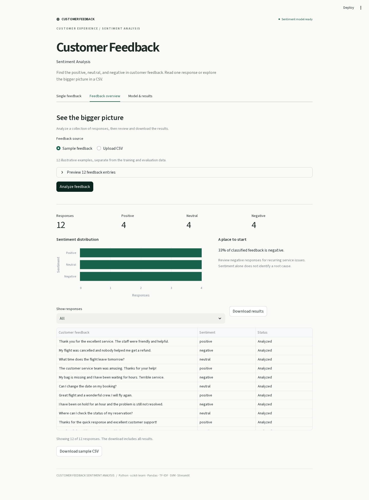
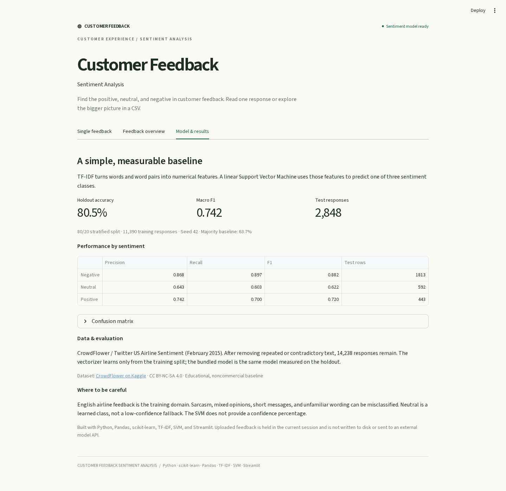

# Customer Feedback Sentiment Analysis

**ML-based customer experience and sentiment analytics.**

A minimal Streamlit application that classifies customer feedback as **positive**, **neutral**, or **negative** using **TF-IDF + SVM**. Review individual responses or explore sentiment across a CSV to support service improvement.

Python · scikit-learn · Pandas · TF-IDF · SVM · Streamlit

## Demo screenshots

Captured from the running Streamlit app with the bundled TF-IDF + SVM model. The overview uses the 12 illustrative sample responses.

**Single feedback**  
Choose an example or enter a response, then select **Analyze sentiment**.



<details>
<summary>Feedback overview and model results</summary>

**Feedback overview**  
Analyze the sample CSV or upload feedback to see sentiment counts, a distribution chart, filters, and downloadable predictions.



**Model & results**  
Review holdout accuracy, macro F1, and precision and recall for each sentiment class.



</details>

## What the application does

- **Single feedback:** enter a review or message and see its predicted sentiment.
- **Feedback overview:** upload a CSV, select the feedback column, and analyze up to 5,000 responses.
- **Sentiment analytics:** view positive, neutral, and negative counts, a distribution chart, and filtered responses.
- **Downloads:** export all predictions with a status for every row, including blank or unrecognized feedback.
- **Model results:** inspect measured holdout performance, per-class metrics, and a confusion matrix.

The app runs locally with a bundled trained model. It does not retrain on startup, download data during use, or require an API key. Uploaded feedback remains in the active session and is not saved by the application.

## Run locally

Use **Python 3.12**.

```bash
git clone https://github.com/i-m-invincible/Customer-Feedback-Sentiment-Analysis.git
cd Customer-Feedback-Sentiment-Analysis
python -m venv .venv
```

Activate the environment:

```powershell
# Windows PowerShell
.venv\Scripts\Activate.ps1
```

```bash
# macOS / Linux
source .venv/bin/activate
```

Install and launch:

```bash
python -m pip install -r requirements.txt
python -m streamlit run app.py
```

Open the local address printed by Streamlit. Start with the three single-feedback examples or the 12-row sample CSV in **Feedback overview**.

## CSV format

Use a UTF-8 CSV with a header row. The column can be named `feedback`, `text`, `review`, or another name; select it in the app.

```csv
feedback
"Thank you for the excellent service. The staff were friendly and helpful."
"What time does the flight leave tomorrow?"
"My flight was cancelled and nobody helped me get a refund."
```

Limits: **5 MB**, **5,000 rows**, and **5,000 characters per response**. Rows with empty text, no known vocabulary, or excessive length are retained as `unclassified` with an explanatory status. The chart counts only classified responses. Downloads contain all rows, regardless of the current filter, and escape formula-like values for safer spreadsheet opening.

## Model and evaluation

| Item | Implementation |
| --- | --- |
| Features | TF-IDF word unigrams and bigrams; up to 30,000 features |
| Classifier | scikit-learn `LinearSVC`, a linear Support Vector Machine |
| Labels | Negative, neutral, positive |
| Data | CrowdFlower / Twitter US Airline Sentiment, February 2015 |
| Source responses | 14,640 |
| Usable responses | 14,238 after normalized-text deduplication and conflict removal |
| Split | Stratified 80/20 holdout, random state 42 |
| Training / test | 11,390 / 2,848 |
| Holdout accuracy | **80.55%** |
| Macro F1 | **0.7416** |
| Majority-class baseline accuracy | 63.66% |

The vectorizer is fitted **only on training data**. Repeated text and contradictory annotations are removed before splitting. The bundled artifact is the exact model evaluated on the holdout; it is not refitted using test responses. The source CSV and model artifact have recorded SHA-256 hashes. Only the trusted bundled model is loaded; model uploads are not supported.

Full measurements: [`artifacts/metrics.json`](artifacts/metrics.json). Data origin, transformations, attribution, and license: [`data/SOURCES.md`](data/SOURCES.md).

**Limits of the baseline:** it learns from English airline feedback. These results do not establish accuracy in other business domains. Sarcasm, mixed sentiment, short messages, and unfamiliar wording can be misclassified. Neutral is a learned class. `LinearSVC` does not return probabilities, so the application does not display a confidence percentage. Review original responses before making service decisions.

The dataset and its adaptation are supplied under **CC BY-NC-SA 4.0** for an educational, noncommercial demonstration. Credit for the original data belongs to CrowdFlower and the original contributors. The 12 sample messages are illustrative interface examples, separate from training and evaluation.

## Reproduce training

```bash
python train.py
```

This uses the included `data/feedback.csv.gz` and regenerates both files in `artifacts/`. For a different labelled dataset, provide `text` and `sentiment` columns with the same three labels:

```bash
python train.py --data path/to/feedback.csv --output artifacts
```

## Verification

```bash
python -m unittest discover -s tests -v
```

The 12 tests cover the three sentiment classes, invalid inputs, CSV limits, downloads, artifact verification, startup without training, the Streamlit forms and batch filter, and reproduction of published metrics from the saved model.

## Streamlit deployment

The repository contains the trained model and pinned requirements. In Streamlit Community Cloud, select this repository, branch **`main`**, entrypoint **`app.py`**, and Python **3.12** in advanced settings. The project is ready for deployment; no public live URL is claimed here.

## Project layout

| Path | Purpose |
| --- | --- |
| `app.py` | Streamlit interface and session state |
| `sentiment.py` | Text cleanup, model loading, CSV analysis, and export |
| `train.py` | Reproducible TF-IDF + SVM training and evaluation |
| `artifacts/` | Trained pipeline and measured results |
| `data/` | Adapted labelled data, illustrative samples, and attribution |
| `tests/` | Model, data handling, and Streamlit application checks |
| `.streamlit/config.toml` | Minimal light theme and upload limit |

The implementation stays within the résumé stack: Python, scikit-learn, Pandas, TF-IDF, SVM, and Streamlit.
